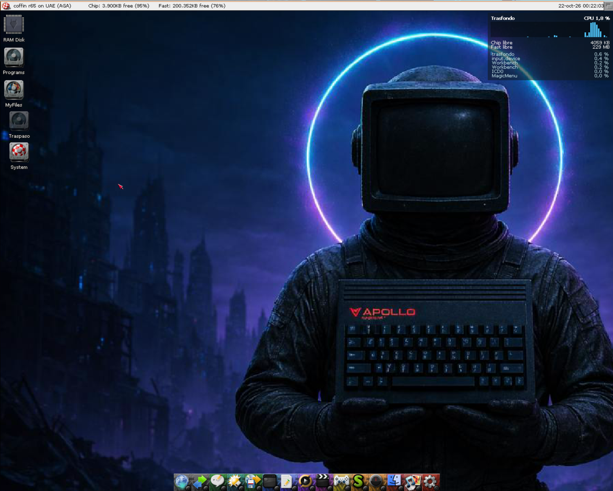
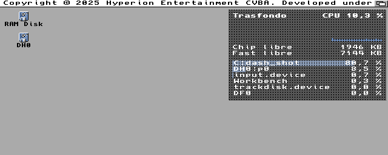
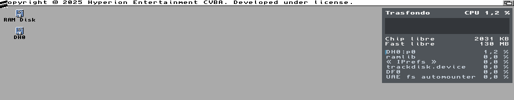
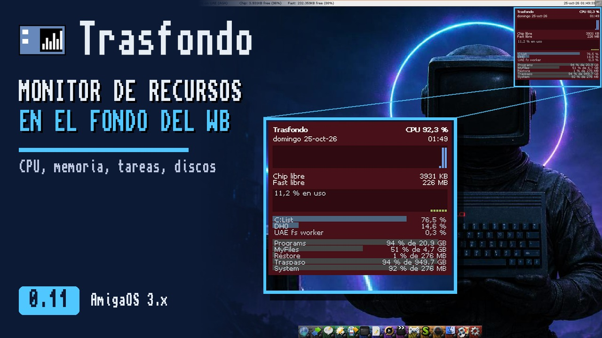

# Trasfondo

*[English](README.md) | Castellano*

Monitor de recursos para el Workbench de **Commodore Amiga** (AmigaOS 3.x): un "top" gráfico pintado en el
propio fondo de pantalla, detrás de los iconos y las ventanas. No se puede pulsar: solo está ahí, de fondo.

Arriba a la derecha del escritorio enseña:

- La fecha y la hora, en el idioma del sistema.
- La CPU en uso y su historia: las últimas 60 medidas (dos minutos, midiendo cada 2 s).
- En una PiStorm (Emu68), la temperatura de su Raspberry Pi; en naranja desde 70 °C.
- La memoria Chip y Fast libre.
- Las seis tareas que más CPU toman.
- Los discos montados: cuánto está lleno cada uno y su tamaño.
- La red: lo que entra y sale por segundo (en KB/s si la pila o el driver dan los bytes; si no, en paquetes), y la señal de la WiFi si la tarjeta la da. Con cualquier pila
  TCP/IP (Roadshow, MiamiDx, AmiTCP...).
- Si se pide (TrasfondoPrefs, o `MEMGRAPH` y `NETGRAPH`), la gráfica de la memoria en uso y la de la red: lo que entra hacia arriba y lo que sale hacia
  abajo, a la escala del máximo de la historia.

Mide y se actualiza cada 2 segundos, o cada 1, 5 o 10 si se prefiere (menos a menudo, menos CPU). Los iconos quedan por encima del panel, como siempre.

Habla inglés de serie y castellano con su catálogo (`Trasfondo.catalog`, que pone el instalador): sale en el
idioma que tengas elegido en las Preferencias de idioma del sistema.



En AmigaOS 3.2.3, pantalla AGA de 640x256:



En una tarjeta gráfica (RTG), a 1024x768 y 32 bits de color (parte de arriba de la pantalla):



**Vídeo** (5 min): Trasfondo 0.11 en Coffin R65 con tarjeta gráfica: cómo se instala, todo lo que enseña, cómo se
pone al día solo con un clic, TrasfondoPrefs y Exchange. En [YouTube](https://youtu.be/QyzxsXAyeg4) (también
[en inglés](https://youtu.be/asdHx5MZsJA)).

[](https://youtu.be/QyzxsXAyeg4)

## Novedades de la 2.0

La 2.0 añade piezas para la pantalla del Workbench, cada una un programa aparte que se arranca o no:

- **TrasfondoBarra**: una barra arriba con la hora, la fecha, el tiempo, la CPU y la memoria. Al pulsarla salen
  sus paneles: **TrasfondoPanel** (reloj, calendario, tiempo y avisos) y **TrasfondoRapido** (ajustes rápidos:
  preferencias, red, memoria, reiniciar). Puede ser una barra entera arriba o ir dentro de la barra de título de
  la pantalla, a la derecha, sin taparla (TrasfondoPrefs, sección Barra, "Estilo"; o `ESTILO=TITULO`). Se queda
  detrás de las demás ventanas, como la barra de título del Workbench, o siempre delante ("Profundidad"; o
  `PROFUNDIDAD=DELANTE`). En la
  misma sección se elige qué enseña: la fecha, el tiempo, la CPU, la memoria y la temperatura (la hora, los
  avisos y el botón de los ajustes salen siempre).
- **Avisos**: la orden `Avisa` (en `C:`) saca un aviso arriba a la derecha (**TrasfondoAviso**) y lo deja en
  la lista del panel. Por ejemplo, `Avisa "Copia hecha"`. La barra tiene además un puerto ARexx, `TRASFONDO`:
  `ADDRESS TRASFONDO 'NOTIFY TITLE="Copia hecha" TEXT="12 ficheros"'` deja un aviso, `COUNT` dice cuántos hay
  (en `RESULT`) y `CLEAR` los quita. Los programas escritos en Dash avisan con `notify(titulo, texto)`.
- **Capturas de pantalla** (las pidió JaviTecH): Ctrl + Alt izquierdo + S, el botón de la cámara en los ajustes
  rápidos o `ADDRESS TRASFONDO 'SCREENSHOT'` guardan la pantalla de delante como PNG, con la fecha y la hora en el
  nombre (`Trasfondo-20261109-192634.png`). Van a `RAM:` si no se elige otra carpeta; la tecla y la carpeta están
  en TrasfondoPrefs, sección Barra. Un aviso dice dónde quedó la imagen.
- **TrasfondoDock**: un dock con los programas abiertos y los que fijes, cada uno en una casilla igual, con su
  icono a la medida. Al pasar el ratón, la casilla se resalta y sale el nombre del programa. Se fija un programa
  soltando su icono encima; se cambia de sitio arrastrándolo, y se quita o se fija manteniendo pulsado el botón.
  Si se pide (TrasfondoPrefs, o `ESCONDER=SI`), se esconde solo y deja una rayita en el borde: sale al llevar el
  ratón allí. Sus programas se editan en TrasfondoPrefs, sección Dock, "Lanzadores...": una lista con Añadir
  (con el selector de ficheros), Quitar, Subir y Bajar. En la misma sección, el hueco entre los iconos y el fondo:
  el del tema, transparente (se ve el escritorio y quedan solo las placas de los iconos) o de un color R,G,B.
- **TrasfondoVentanas**: las ventanas de cualquier programa como en un escritorio de ahora, sin parchear el
  sistema. Soltar una ventana arrastrada contra un borde la encaja: a la izquierda o a la derecha, la mitad; en una
  esquina, ese cuarto; arriba, la pantalla entera. Al alejarla del borde recupera su tamaño. Un doble clic en la
  barra de título la maximiza y otro la deja como estaba. El clic central en la barra de título (o Ctrl Alt
  Espacio) abre el menú de la ventana: maximizar, mitades, cuartos, delante, detrás, encoger y cerrar. Alt+Tab
  cambia de ventana con una lista. Además, teclas para maximizar, las mitades y el mosaico, a mano o automático, y
  mover o cambiar de tamaño con Alt y el ratón; al mover así, un marco enseña dónde encajará. Todo se quita o se
  cambia en TrasfondoPrefs, sección Ventanas.
- **TrasfondoArchivos**: un explorador de ficheros moderno, como el Nautilus de Linux, dibujado con los colores de
  Trasfondo (necesita MUI). A la izquierda los sitios, los discos y la papelera; arriba atrás, adelante, subir y la
  ruta en trozos que se pulsan; en medio una lista con columnas que ordenan o iconos con miniaturas de las
  imágenes. Con F3, dos paneles como en Directory Opus: el activo es el origen y el otro el destino; F5 copia y F6
  mueve al otro. Copiar, mover y borrar van con barra de progreso y se pueden cancelar; si algo ya existe, pregunta.
  Borrar manda a la papelera de cada disco, y Amiga+Z deshace. También renombrar en el sitio (F2), cajón nuevo,
  filtrar (Amiga+F), buscar en los subcajones (Amiga+B), información con comentario y permisos (Amiga+I) y
  arrastrar y soltar, también iconos desde el Workbench. Los .info van siempre con su fichero.
- **Colores**: la barra, los paneles y el dock toman los colores del fondo de escritorio, en oscuro o claro,
  con seis esquemas, uno de ellos con los colores del Workbench. TrasfondoPrefs enseña una vista previa.
- **TrasfondoPrefs** va por secciones (fondo, barra, dock, ventanas, colores y arranque). En Arranque, marcar
  una pieza la pone en marcha y hace que arranque con el Workbench; quitar la marca la para y deja de arrancar.

La barra, sus paneles y el dock necesitan una tarjeta gráfica (RTG, 15 bits o más). El fondo y las ventanas
funcionan en cualquier pantalla.

## Escrito en Dash

Trasfondo está escrito entero en [Dash](https://github.com/FreeMEM/dash), un lenguaje de alto nivel para
Amiga que se traduce a C y se compila a un ejecutable nativo de 68k. No lleva C a mano: el panel del fondo son unas 1.100
líneas de Dash en [src/trasfondo.dash](src/trasfondo.dash), y todas las piezas juntas, unas 6.300.

Lo que Dash no sabía hacer se le añadió como funciones propias del lenguaje (builtins):

- `desktop_canvas`, `desktop_canvas_on_draw`, `desktop_canvas_update`, `desktop_canvas_update_area`: pintar en
  el fondo del Workbench, y repintar solo lo que cambia.
- `desktop_canvas_veil`, `desktop_canvas_veil_rect`, `desktop_canvas_drawing`: el velo del panel, mezclado
  con el fondo una sola vez, y saltarse lo que no se repinta.
- `cpu_start`, `cpu_sample`, `cpu_total`, `cpu_task_name`, `cpu_task_load`: la CPU total y la de cada tarea.
- `single_instance` y `break_check`: una sola copia en marcha, y pararla con Ctrl-C.
- `tooltype`, `cx_broker`, `cx_hotkey`, `cx_wait`: una commodity con sus tooltypes.
- `disks_read`, `disk_kb`, `disk_free_kb`: los discos, sin esperar a uno lento.
- `net_ifs_read`, `net_if_bytes_in`, `net_drivers_read`, `net_driver_read`, `wifi_read`, `wifi_read_device`: la red
  y la WiFi, con un tiempo máximo para cada pregunta.
- `pistorm_temperature`: la temperatura de la Raspberry Pi de una PiStorm, preguntada a su firmware por Emu68.

Así, cualquier otro programa en Dash puede usarlas también.

## Requisitos

- **AmigaOS 3.0 o posterior** (Kickstart 39). Usa funciones de `graphics.library` y `layers.library` que
  llegaron con la versión 39.
- **Workbench en marcha**: el panel se pinta en su fondo.
- **Cualquier 68k**: el ejecutable es código de 68000 y no usa FPU.
- **Chipset nativo (OCS, ECS, AGA) o tarjeta gráfica (RTG)**. Con RTG usa `cybergraphics.library` o
  `Picasso96API.library` si están.
- **Memoria**: el fondo ocupa 136 KB; todas las piezas juntas, unos 820 KB en disco.
- **Red y WiFi: cualquier pila TCP/IP.** Con Roadshow, lo que entra y sale en bytes por segundo de cada
  interfaz. Con otra pila (MiamiDx, AmiTCP...), Trasfondo pregunta al driver de la tarjeta (el de
  `DEVS:Networks/` que esté en uso) y da paquetes por segundo: los drivers no cuentan bytes. La señal de la
  WiFi la tiene que dar el driver (`wifipi.device` de Emu68, `prism2.device` y otros de Neil Cafferkey la dan).
  Ninguna pregunta espera más de un tercio de segundo: un driver que no contesta no cuelga el sistema.

Dónde se ha probado:

| Sistema | Máquina | Pantalla |
|---|---|---|
| AmigaOS 3.2.3 | A1200 emulado (FS-UAE), 68020 | AGA, 640x256, 4 colores |
| AmigaOS 3.2.3 | A1200 emulado (FS-UAE), 68040 | RTG (uaegfx), 1024x768, 32 bits |
| Coffin R65 | Amiberry, 68040 | RTG, 1024x768, fondo con imagen |

La parte de red y WiFi se ha probado en el emulador con un driver de red falso (señal y paquetes); no aún
con Roadshow, MiamiDx ni una tarjeta WiFi de verdad.

Sin probar todavía: AmigaOS 3.0, 3.1 y 3.9, un 68000 real, OCS/ECS y el Workbench sin ventana de fondo
(backdrop).

## Instalación y uso

1. Descomprime `trasfondo-2.9.lha` (de la página de
   [releases](https://github.com/FreeMEM/trasfondo/releases)) en cualquier cajón: sale el cajón `Trasfondo`.
2. Doble clic en **Instalar**. Pregunta dónde dejar el cajón `Trasfondo` con todas las piezas y cuáles
   arrancan con el Workbench (pone sus iconos en `SYS:WBStartup`). Pone **TrasfondoPrefs** en `SYS:Prefs`, la
   orden `Avisa` en `C:` y el catálogo en castellano en `LOCALE:Catalogs`. Si tenías una versión anterior, la
   quita.
3. Lánzalo con doble clic, o desde el Shell con `run trasfondo`.
4. Para pararlo, lánzalo otra vez, usa Eliminar en Exchange o pulsa Ctrl-C en su Shell. El fondo queda
   como estaba.

Sin instalador también vale: copia `trasfondo` y `trasfondo.info` a donde quieras, y el cajón `Catalogs`
a su lado para tenerlo en castellano. En `SYS:WBStartup`
arranca solo; su icono lleva el tooltype `DONOTWAIT`, para que el Workbench no se quede esperando a que
acabe (si falta, pregunta "El programa no ha terminado aún. ¿Espero un poco más?").

### Preferencias

**TrasfondoPrefs** (en `SYS:Prefs`) dice qué se ve, cuántas tareas, la tecla rápida, cada cuánto mide, el
fondo (transparente o fijo) y su color, la esquina de la pantalla donde va el panel (arriba a la derecha si no se
dice; no se pone debajo de la barra ni del dock), y si arranca oculto.
**Usar** lo aplica hasta reiniciar y **Guardar**, para siempre (`ENV:` y `ENVARC:Trasfondo.prefs`).
Trasfondo, si está en marcha, cambia al momento, sin reiniciarlo (el sistema le avisa cuando cambian). Lo
que pone TrasfondoPrefs manda sobre los tooltypes del icono.

### Ponerse al día solo

Desde la 0.8, Trasfondo mira en GitHub si hay una versión nueva: un minuto después de arrancar y luego cada
hora (hasta la 2.3, cada seis horas), sin esperar ni frenar el panel. Si la hay, sale un piloto verde con su número junto a
"Trasfondo". En TrasfondoPrefs, **Actualizar** la baja (los ejecutables sueltos de la release),
comprueba que llegó entera y que es la versión que dice, deja los de ahora como `.old` y Trasfondo vuelve a
arrancar con la nueva. Desde la 0.9 baja también el catálogo en castellano; y si tu sistema está en
castellano y falta, lo baja él solo al minuto de arrancar (le pasa a quien llega a la 0.9 desde la 0.8 con
el botón).

Necesita una pila TCP/IP en marcha y AmiSSL; sin ellas no hace nada (y no pone en marcha la red: si no hay pila, espera a que la haya). Al acabar cada consulta suelta la red. Solo pregunta a `api.github.com`, y la casilla
**Buscar versiones nuevas en GitHub** de TrasfondoPrefs lo apaga. Las versiones hasta la 0.7 no lo traen:
para llegar a la 0.8 hay que instalarla a mano una vez.

Desde la 2.1, el botón trae todas las piezas: el fondo, TrasfondoPrefs, la barra y sus paneles, el dock, las
ventanas y la orden `Avisa`. Quien llegue desde la 0.11 o la 2.0 recibe primero el fondo nuevo, y este, al
arrancar, baja solo las piezas que faltan y las deja a su lado, con sus iconos de arranque: después se elige en
TrasfondoPrefs cuáles arrancan con el Workbench. Las piezas que estén en marcha siguen con la versión de antes
hasta que vuelvan a arrancar (quitar y volver a poner su marca en Arranque lo hace).

### Desde Exchange

Trasfondo es una commodity: sale en Exchange (`SYS:Tools/Commodities/Exchange`). La barra, el dock y las
ventanas también salen: Eliminar las para; Ocultar o Desactivar esconden la barra y el dock, y Mostrar o
Activar los traen.

| Botón | Qué hace |
|---|---|
| Ocultar | Quita el panel. Sigue midiendo: al mostrarlo, la historia de la CPU está completa. |
| Mostrar | Vuelve a poner el panel. |
| Desactivar | Quita el panel y deja de medir. No gasta nada mientras tanto. |
| Activar | Vuelve a medir, con la historia vacía. |
| Eliminar | Lo cierra y deja el fondo como estaba. |

### Tooltypes

Se cambian en el icono (Información, en el menú Iconos) o se dan como argumentos en el Shell
(`run trasfondo CX_POPKEY="ctrl alt t"`).

| Tooltype | Qué hace |
|---|---|
| `SHOW=DATE,CPU,TEMP,MEMORY,TASKS,DISKS,NET` | Qué secciones salen y en qué orden (DATE es la fecha y la hora; TEMP, la temperatura de la PiStorm, que sin Emu68 no sale). Se pueden añadir `MEMGRAPH` y `NETGRAPH`, las gráficas de la memoria y de la red, que no salen de serie. Por ejemplo, `SHOW=CPU,DISKS` enseña solo la CPU y los discos. Lo que no sale tampoco se mide. En castellano también vale: `MOSTRAR=FECHA,CPU,TEMPERATURA,MEMORIA,TAREAS,DISCOS,RED`. |
| `TASKS=6` | Cuántas tareas enseña (de 1 a 20). También `TAREAS=6`. |
| `VOLUMES=Work,Descargas` | Qué discos salen, y en ese orden, aunque sean más de ocho. Sin él, todos hasta ocho, menos RAM: y los vacíos (menos de 1 MB ocupado, como un "Empty" recién formateado). También `UNIDADES=`, y en TrasfondoPrefs, "Unidades" (lo pidió Ferrán García). |
| `CX_POPKEY=ctrl alt t` | Tecla rápida para ocultar y mostrar el panel. En el icono viene entre paréntesis, apagada: quítaselos para usarla. |
| `INTERVAL=2` | Cada cuántos segundos mide y repinta (de 1 a 60). |
| `BACKGROUND=SOLID` | Fondo fijo, sin velo transparente: gasta menos CPU. |
| `COLOR=16,24,32` | Color del fondo, en rojo, verde y azul (de 0 a 255). |
| `SEGUNDOS=SI` | La hora con segundos, en el fondo y en la barra (o "Ver los segundos" en TrasfondoPrefs). |
| `POSICION=ABAJO_IZQUIERDA` | La esquina del panel: `ARRIBA_DERECHA` (la de siempre), `ARRIBA_IZQUIERDA`, `ABAJO_DERECHA` o `ABAJO_IZQUIERDA`. |
| `CX_POPUP=NO` | Arranca oculto. |
| `CX_PRIORITY=0` | Prioridad de la commodity. |
| `DONOTWAIT` | En `WBStartup`, el Workbench no espera a que acabe. |

## Cómo funciona

El Workbench rellena su fondo con una función propia (un "gancho" de la capa). Trasfondo pone la suya:
primero llama a la del Workbench, que pinta el fondo de siempre, y luego copia encima el panel. Los
iconos los pinta el Workbench después, así que quedan por encima.

En cada medida se repintan solo las partes del panel que cambiaron, sin borrar los iconos: se lee la zona
de la pantalla, lo que ha cambiado respecto al panel anterior es un icono, y el panel nuevo se copia solo
fuera de eso. El velo transparente se mezcla con el fondo una sola vez, no en cada medida.

Lo que gasta, medido en el emulador con el defecto de una medida cada 2 s: un 8 % de un A1200 y un 11 % de
un 68030 con tarjeta gráfica (antes de la 0.10, midiendo cada segundo, un 21 % y casi todo el 68030). Se mide
con `tests/medir_cpu.py`.

La CPU de cada tarea se mide con los ganchos de cambio de tarea de exec, como hace PM. No es una
estimación: es el tiempo real que cada tarea pasa en la CPU.

## Límites conocidos

- En pantallas de 256 colores o menos (AGA, ECS, RTG de 8 bits) el panel lleva siempre fondo fijo: el
  velo semitransparente solo se puede imitar con una trama de puntos, que sobre un fondo claro no se lee.
  La transparencia queda para RTG de 15 bits o más.
- Con una tarjeta gráfica en el bus Zorro cada repintado lee y escribe la memoria de la tarjeta, que por ese
  bus es lenta: ahí se nota más lo que gasta. Medir cada más segundos y el fondo fijo lo bajan.
- La posición aún no se puede cambiar.
- La barra y el dock son ventanas normales: otra ventana puede taparlos.
- Si un píxel de un icono coincide en color con el panel anterior en ese punto, se toma por fondo y el
  panel lo pisa hasta que el Workbench vuelva a pintar el icono.

## Compilar

Hace falta Dash y su compilador cruzado (`m68k-amigaos-gcc`). Desde la raíz de este repositorio:

```bash
DASH=/ruta/a/dash
PYTHONPATH=$DASH $DASH/dash src/trasfondo.dash -o build/trasfondo
```

El icono se genera con `tools/icono.py`, que usa el generador de iconos de dashweb.

## Plan

Lo que viene (más paneles, posición y colores por tooltypes, paquete para Aminet) está en [docs/PLAN.md](docs/PLAN.md).

## Licencia

MIT (ver [LICENSE](LICENSE)).
