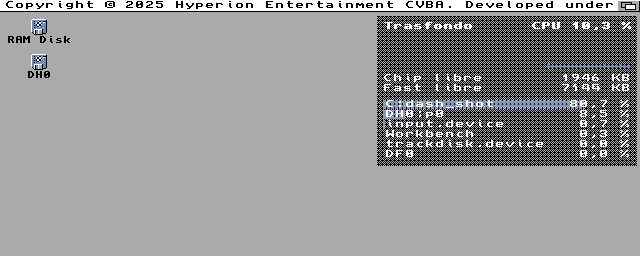

# Trasfondo

Monitor de recursos para el Workbench de **Commodore Amiga** (AmigaOS 3.x): un "top" gráfico pintado en el
propio fondo de pantalla, detrás de los iconos y las ventanas. No se puede pulsar: solo está ahí, de fondo.

Arriba a la derecha del escritorio enseña:

- La CPU en uso y su historia del último minuto.
- La memoria Chip y Fast libre.
- Las seis tareas que más CPU toman.

Se actualiza cada segundo. Los iconos quedan por encima del panel, como siempre.



## Escrito en Dash

Trasfondo está escrito entero en [Dash](https://github.com/FreeMEM/dash), un lenguaje de alto nivel para
Amiga que se traduce a C y se compila a un ejecutable nativo de 68k. No lleva C a mano: todo el programa
son unas 130 líneas de Dash en [src/trasfondo.dash](src/trasfondo.dash).

Lo que Dash no sabía hacer se le añadió como funciones propias del lenguaje (builtins):

- `desktop_canvas`, `desktop_canvas_on_draw`, `desktop_canvas_update`: pintar en el fondo del Workbench.
- `cpu_start`, `cpu_sample`, `cpu_total`, `cpu_task_name`, `cpu_task_load`: la CPU total y la de cada tarea.
- `single_instance` y `break_check`: una sola copia en marcha, y pararla con Ctrl-C.

Así, cualquier otro programa en Dash puede usarlas también.

## Uso

1. Copia `trasfondo` y `trasfondo.info` a cualquier cajón.
2. Lánzalo con doble clic, o desde el Shell con `run trasfondo`.
3. Para pararlo, lánzalo otra vez, o pulsa Ctrl-C en su Shell. El fondo queda como estaba.

Probado en AmigaOS 3.2.3 (A1200 emulado) y en Coffin R65 (68040, RTG a 1024x768, fondo con imagen).

## Compilar

Hace falta Dash y su compilador cruzado (`m68k-amigaos-gcc`). Desde la raíz de este repositorio:

```bash
DASH=/ruta/a/dash
PYTHONPATH=$DASH $DASH/dash src/trasfondo.dash -o build/trasfondo
```

El icono se genera con `tools/icono.py`, que usa el generador de iconos de dashweb.

## Plan

Lo que viene (tooltypes, más paneles, commodity, paquete para Aminet) está en [docs/PLAN.md](docs/PLAN.md).

## Licencia

MIT (ver [LICENSE](LICENSE)).
