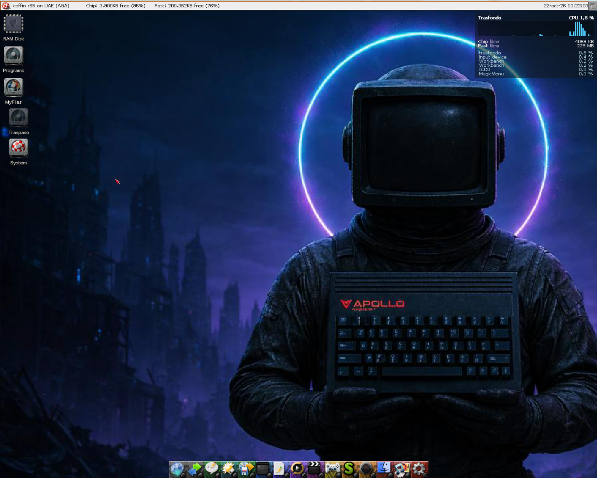
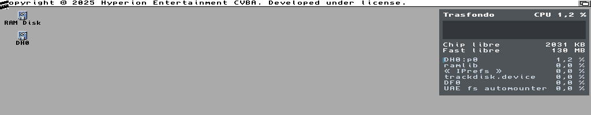
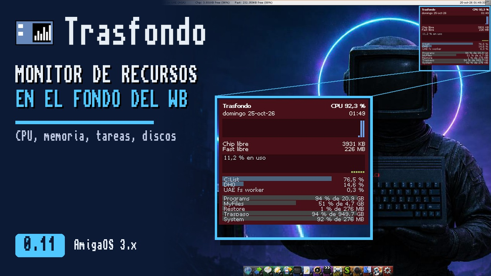

# Trasfondo

Monitor de recursos para el Workbench de **Commodore Amiga** (AmigaOS 3.x): un "top" gráfico pintado en el
propio fondo de pantalla, detrás de los iconos y las ventanas. No se puede pulsar: solo está ahí, de fondo.

Arriba a la derecha del escritorio enseña:

- La fecha y la hora, en el idioma del sistema.
- La CPU en uso y su historia del último minuto.
- La memoria Chip y Fast libre.
- Las seis tareas que más CPU toman.
- Los discos montados: cuánto está lleno cada uno y su tamaño.
- La red: lo que entra y sale por segundo (en KB/s si la pila o el driver dan los bytes; si no, en paquetes), y la señal de la WiFi si la tarjeta la da. Con cualquier pila
  TCP/IP (Roadshow, MiamiDx, AmiTCP...).

Se actualiza cada segundo. Los iconos quedan por encima del panel, como siempre.



En AmigaOS 3.2.3, pantalla AGA de 640x256:


En una tarjeta gráfica (RTG), a 1024x768 y 32 bits de color (parte de arriba de la pantalla):



**Vídeo** (6 min, en castellano): cómo se instala y cómo se usa, en Coffin R65, en AGA y con tarjeta gráfica
(RTG). En [YouTube](https://youtu.be/vMqksMRh4rI) o para
[descargar](https://github.com/FreeMEM/trasfondo/releases/download/v0.3/trasfondo-0.3.mp4).

[](https://youtu.be/vMqksMRh4rI)

## Escrito en Dash

Trasfondo está escrito entero en [Dash](https://github.com/FreeMEM/dash), un lenguaje de alto nivel para
Amiga que se traduce a C y se compila a un ejecutable nativo de 68k. No lleva C a mano: todo el programa
son unas 500 líneas de Dash en [src/trasfondo.dash](src/trasfondo.dash).

Lo que Dash no sabía hacer se le añadió como funciones propias del lenguaje (builtins):

- `desktop_canvas`, `desktop_canvas_on_draw`, `desktop_canvas_update`: pintar en el fondo del Workbench.
- `cpu_start`, `cpu_sample`, `cpu_total`, `cpu_task_name`, `cpu_task_load`: la CPU total y la de cada tarea.
- `single_instance` y `break_check`: una sola copia en marcha, y pararla con Ctrl-C.
- `tooltype`, `cx_broker`, `cx_hotkey`, `cx_wait`: una commodity con sus tooltypes.
- `disks_read`, `disk_kb`, `disk_free_kb`: los discos, sin esperar a uno lento.
- `net_ifs_read`, `net_if_bytes_in`, `net_drivers_read`, `net_driver_read`, `wifi_read`, `wifi_read_device`: la red
  y la WiFi, con un tiempo máximo para cada pregunta.

Así, cualquier otro programa en Dash puede usarlas también.

## Requisitos

- **AmigaOS 3.0 o posterior** (Kickstart 39). Usa funciones de `graphics.library` y `layers.library` que
  llegaron con la versión 39.
- **Workbench en marcha**: el panel se pinta en su fondo.
- **Cualquier 68k**: el ejecutable es código de 68000 y no usa FPU.
- **Chipset nativo (OCS, ECS, AGA) o tarjeta gráfica (RTG)**. Con RTG usa `cybergraphics.library` o
  `Picasso96API.library` si están.
- **Memoria**: el ejecutable ocupa 62 KB.
- **Red y WiFi: cualquier pila TCP/IP.** Con Roadshow, lo que entra y sale en bytes por segundo de cada
  interfaz. Con otra pila (MiamiDx, AmiTCP...), Trasfondo pregunta al driver de la tarjeta (el de
  `DEVS:Networks/` que esté en uso) y da paquetes por segundo: los drivers no cuentan bytes. La señal de la
  WiFi la tiene que dar el driver (`wifipi.device` de Emu68, `prism2.device` y otros de Neil Cafferkey la dan).
  Ninguna pregunta espera más de un tercio de segundo: un driver que no contesta no cuelga el sistema.

Dónde se ha probado:

| Sistema | Máquina | Pantalla |
|---|---|---|
| AmigaOS 3.2.3 | A1200 emulado (FS-UAE), 68020 | AGA, 640x256, 4 colores |
| AmigaOS 3.2.3 | A1200 emulado (FS-UAE), 68040 | RTG (uaegfx), 1024x768, 32 bits |
| Coffin R65 | Amiberry, 68040 | RTG, 1024x768, fondo con imagen |

La parte de red y WiFi se ha probado en el emulador con un driver de red falso (señal y paquetes); no aún
con Roadshow, MiamiDx ni una tarjeta WiFi de verdad.

Sin probar todavía: AmigaOS 3.0, 3.1 y 3.9, un 68000 real, OCS/ECS y el Workbench sin ventana de fondo
(backdrop).

## Instalación y uso

1. Descomprime `trasfondo-0.8.lha` (de la página de
   [releases](https://github.com/FreeMEM/trasfondo/releases)) en cualquier cajón: sale el cajón `Trasfondo`.
2. Doble clic en **Instalar**. Pregunta si quieres que Trasfondo arranque solo con el Workbench (lo copia
   a `SYS:WBStartup`) o en qué cajón lo dejas, y pone sus preferencias, **TrasfondoPrefs**, en
   `SYS:Prefs`.
3. Lánzalo con doble clic, o desde el Shell con `run trasfondo`.
4. Para pararlo, lánzalo otra vez, usa Eliminar en Exchange o pulsa Ctrl-C en su Shell. El fondo queda
   como estaba.

Sin instalador también vale: copia `trasfondo` y `trasfondo.info` a donde quieras. En `SYS:WBStartup`
arranca solo; su icono lleva el tooltype `DONOTWAIT`, para que el Workbench no se quede esperando a que
acabe (si falta, pregunta "El programa no ha terminado aún. ¿Espero un poco más?").

### Preferencias

**TrasfondoPrefs** (en `SYS:Prefs`) dice qué se ve, cuántas tareas, la tecla rápida y si arranca oculto.
**Usar** lo aplica hasta reiniciar y **Guardar**, para siempre (`ENV:` y `ENVARC:Trasfondo.prefs`).
Trasfondo, si está en marcha, cambia al momento, sin reiniciarlo (el sistema le avisa cuando cambian). Lo
que pone TrasfondoPrefs manda sobre los tooltypes del icono.

### Ponerse al día solo

Desde la 0.8, Trasfondo mira en GitHub si hay una versión nueva: un minuto después de arrancar y luego cada
seis horas, sin esperar ni frenar el panel. Si la hay, sale un piloto verde con su número junto a
«Trasfondo». En TrasfondoPrefs, **Actualizar** la baja (los dos ejecutables sueltos de la release),
comprueba que llegó entera y que es la versión que dice, deja los de ahora como `.old` y Trasfondo vuelve a
arrancar con la nueva.

Necesita una pila TCP/IP y AmiSSL; sin ellas no hace nada. Solo pregunta a `api.github.com`, y la casilla
**Buscar versiones nuevas en GitHub** de TrasfondoPrefs lo apaga. Las versiones hasta la 0.7 no lo traen:
para llegar a la 0.8 hay que instalarla a mano una vez.

### Desde Exchange

Trasfondo es una commodity: sale en Exchange (`SYS:Tools/Commodities/Exchange`).

| Botón | Qué hace |
|---|---|
| Ocultar | Quita el panel. Sigue midiendo: al mostrarlo, la historia de la CPU está completa. |
| Mostrar | Vuelve a poner el panel. |
| Desactivar | Quita el panel y deja de medir. No gasta nada mientras tanto. |
| Activar | Vuelve a medir, con la historia vacía. |
| Eliminar | Lo cierra y deja el fondo como estaba. |

### Tooltypes

Se cambian en el icono (Información, en el menú Iconos) o se dan como argumentos en el Shell
(`run trasfondo CX_POPKEY="ctrl alt t"`).

| Tooltype | Qué hace |
|---|---|
| `MOSTRAR=FECHA,CPU,MEMORIA,TAREAS,DISCOS,RED` | Qué secciones salen y en qué orden (FECHA es la fecha y la hora). Por ejemplo, `MOSTRAR=CPU,DISCOS` enseña solo la CPU y los discos. Lo que no sale tampoco se mide. |
| `TAREAS=6` | Cuántas tareas enseña (de 1 a 20). |
| `CX_POPKEY=ctrl alt t` | Tecla rápida para ocultar y mostrar el panel. En el icono viene entre paréntesis, apagada: quítaselos para usarla. |
| `CX_POPUP=NO` | Arranca oculto. |
| `CX_PRIORITY=0` | Prioridad de la commodity. |
| `DONOTWAIT` | En `WBStartup`, el Workbench no espera a que acabe. |

## Cómo funciona

El Workbench rellena su fondo con una función propia (un "gancho" de la capa). Trasfondo pone la suya:
primero llama a la del Workbench, que pinta el fondo de siempre, y luego copia encima el panel. Los
iconos los pinta el Workbench después, así que quedan por encima.

Cada segundo el panel se refresca sin borrar los iconos: se lee la zona de la pantalla, lo que ha
cambiado respecto al panel anterior es un icono, y el panel nuevo se copia solo fuera de eso.

La CPU de cada tarea se mide con los ganchos de cambio de tarea de exec, como hace PM. No es una
estimación: es el tiempo real que cada tarea pasa en la CPU.

## Límites conocidos

- En pantallas de 256 colores o menos (AGA, ECS, RTG de 8 bits) el panel lleva un fondo oscuro sólido: el
  velo semitransparente solo se puede imitar con una trama de puntos, que sobre un fondo claro no se lee.
  La transparencia queda para RTG de 15 bits o más.
- La posición, los colores y lo que se enseña aún no se pueden cambiar (vendrán por tooltypes).
- Si un píxel de un icono coincide en color con el panel anterior en ese punto, se toma por fondo y el
  panel lo pisa hasta que el Workbench vuelva a pintar el icono.

## Compilar

Hace falta Dash y su compilador cruzado (`m68k-amigaos-gcc`). Desde la raíz de este repositorio:

```bash
DASH=/ruta/a/dash
PYTHONPATH=$DASH $DASH/dash src/trasfondo.dash -o build/trasfondo
```

El icono se genera con `tools/icono.py`, que usa el generador de iconos de dashweb.

## Plan

Lo que viene (más paneles, posición y colores por tooltypes, paquete para Aminet) está en [docs/PLAN.md](docs/PLAN.md).

## Licencia

MIT (ver [LICENSE](LICENSE)).
