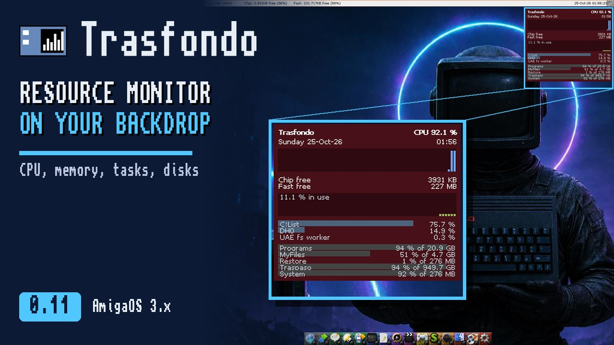

# Trasfondo

*English | [Castellano](README.es.md)*

Resource monitor for the **Commodore Amiga** Workbench (AmigaOS 3.x): a graphical "top" painted on the
backdrop itself, behind the icons and the windows. You can't click it: it just sits there, in the background.

In the top right corner of the desktop it shows:

- The date and time, in the system language.
- CPU usage and its history: the last 60 measurements (two minutes, measuring every 2 s).
- On a PiStorm (Emu68), the temperature of its Raspberry Pi; in orange from 70 °C.
- Free Chip and Fast memory.
- The six tasks using the most CPU.
- The mounted disks: how full each one is and its size.
- The network: what comes in and goes out per second (in KB/s if the stack or the driver gives the bytes; otherwise, in packets), and the WiFi signal if the card gives it. With any
  TCP/IP stack (Roadshow, MiamiDx, AmiTCP...).
- If asked for (TrasfondoPrefs, or `MEMGRAPH` and `NETGRAPH`), the graph of memory in use and the network graph: incoming traffic upwards and outgoing traffic
  downwards, scaled to the maximum in the history.

It measures and updates every 2 seconds, or every 1, 5 or 10 if you prefer (less often, less CPU). The icons stay on top of the panel, as always.

It speaks English out of the box and Spanish with its catalog (`Trasfondo.catalog`, which the installer puts in place): it uses the
language you have chosen in the system's Locale preferences.


On AmigaOS 3.2.3, 640x256 AGA screen:


On a graphics card (RTG), at 1024x768 and 32-bit colour (top part of the screen):


**Video** (5 min): Trasfondo 0.11 on Coffin R65 with a graphics card: how to install it, everything it shows, how it
updates itself with one click, TrasfondoPrefs and Exchange. On [YouTube](https://youtu.be/asdHx5MZsJA) (also
[in Spanish](https://youtu.be/QyzxsXAyeg4)).

[](https://youtu.be/asdHx5MZsJA)

## Written in Dash

Trasfondo is written entirely in [Dash](https://github.com/FreeMEM/dash), a high-level language for the
Amiga that is translated to C and compiled into a native 68k executable. There is no hand-written C: the panel is about 1,100
lines of Dash in [src/trasfondo.dash](src/trasfondo.dash), and the whole program, with TrasfondoPrefs, the
updater and the texts, about 2,200.

Whatever Dash couldn't do was added to it as functions built into the language (builtins):

- `desktop_canvas`, `desktop_canvas_on_draw`, `desktop_canvas_update`, `desktop_canvas_update_area`: painting on
  the Workbench backdrop, and repainting only what changes.
- `desktop_canvas_veil`, `desktop_canvas_veil_rect`, `desktop_canvas_drawing`: the panel's veil, blended
  with the backdrop only once, and skipping whatever isn't repainted.
- `cpu_start`, `cpu_sample`, `cpu_total`, `cpu_task_name`, `cpu_task_load`: total CPU and the CPU of each task.
- `single_instance` and `break_check`: only one copy running, and stopping it with Ctrl-C.
- `tooltype`, `cx_broker`, `cx_hotkey`, `cx_wait`: a commodity with its tooltypes.
- `disks_read`, `disk_kb`, `disk_free_kb`: the disks, without waiting for a slow one.
- `net_ifs_read`, `net_if_bytes_in`, `net_drivers_read`, `net_driver_read`, `wifi_read`, `wifi_read_device`: the network
  and the WiFi, with a time limit for each query.
- `pistorm_temperature`: the temperature of a PiStorm's Raspberry Pi, asked of its firmware through Emu68.

That way, any other Dash program can use them too.

## Requirements

- **AmigaOS 3.0 or later** (Kickstart 39). It uses `graphics.library` and `layers.library` functions that
  arrived with version 39.
- **Workbench running**: the panel is painted on its backdrop.
- **Any 68k**: the executable is 68000 code and doesn't use an FPU.
- **Native chipset (OCS, ECS, AGA) or graphics card (RTG)**. With RTG it uses `cybergraphics.library` or
  `Picasso96API.library` if they are present.
- **Memory**: the executable takes up 138 KB.
- **Network and WiFi: any TCP/IP stack.** With Roadshow, incoming and outgoing bytes per second for each
  interface. With another stack (MiamiDx, AmiTCP...), Trasfondo asks the card's driver (the one in
  `DEVS:Networks/` that is in use) and gives packets per second: drivers don't count bytes. The WiFi
  signal has to come from the driver (Emu68's `wifipi.device`, `prism2.device` and others by Neil Cafferkey give it).
  No query waits more than a third of a second: a driver that doesn't answer won't hang the system.

Where it has been tested:

| System | Machine | Screen |
|---|---|---|
| AmigaOS 3.2.3 | Emulated A1200 (FS-UAE), 68020 | AGA, 640x256, 4 colours |
| AmigaOS 3.2.3 | Emulated A1200 (FS-UAE), 68040 | RTG (uaegfx), 1024x768, 32-bit |
| Coffin R65 | Amiberry, 68040 | RTG, 1024x768, backdrop picture |

The network and WiFi part has been tested in the emulator with a fake network driver (signal and packets); not yet
with Roadshow, MiamiDx or a real WiFi card.

Not tested yet: AmigaOS 3.0, 3.1 and 3.9, a real 68000, OCS/ECS and the Workbench without a backdrop
window.

## Installation and use

1. Unpack `trasfondo-0.11.lha` (from the
   [releases](https://github.com/FreeMEM/trasfondo/releases) page) into any drawer: you get the `Trasfondo` drawer.
2. Double-click **Instalar** (the installer). It asks whether you want Trasfondo to start by itself with the Workbench (it copies it
   to `SYS:WBStartup`) or which drawer to leave it in, and puts its preferences, **TrasfondoPrefs**, in
   `SYS:Prefs`, and the Spanish catalog in `LOCALE:Catalogs`.
3. Start it with a double-click, or from the Shell with `run trasfondo`.
4. To stop it, start it again, use Remove in Exchange or press Ctrl-C in its Shell. The backdrop is left
   as it was.

It works without the installer too: copy `trasfondo` and `trasfondo.info` wherever you like, and the `Catalogs` drawer
next to them to have it in Spanish. In `SYS:WBStartup`
it starts by itself; its icon carries the `DONOTWAIT` tooltype, so that the Workbench doesn't sit waiting for it to
finish (without it, it asks "Program has not finished yet. Wait a little longer?").

### Preferences

**TrasfondoPrefs** (in `SYS:Prefs`) sets what is shown, how many tasks, the hotkey, how often it measures, the
background (see-through or solid) and its colour, and whether it starts hidden.
**Use** applies them until you reboot and **Save**, for good (`ENV:` and `ENVARC:Trasfondo.prefs`).
Trasfondo, if it is running, changes straight away, without restarting it (the system tells it when they change).
What TrasfondoPrefs sets takes precedence over the icon's tooltypes.

### Updating itself

Since 0.8, Trasfondo checks GitHub for a new version: one minute after starting and then every
six hours, without waiting or slowing the panel down. If there is one, a green indicator with its number appears next to
"Trasfondo". In TrasfondoPrefs, **Update** downloads it (the two loose executables from the release),
checks that it arrived complete and that it is the version it claims to be, keeps the current ones as `.old` and Trasfondo
restarts with the new one. Since 0.9 it also downloads the Spanish catalog; and if your system is in
Spanish and the catalog is missing, it downloads it by itself a minute after starting (this happens to anyone who moves from 0.8 to 0.9 with
the button).

It needs a running TCP/IP stack and AmiSSL; without them it does nothing (and it doesn't start the network: if there is no stack, it waits until there is one). When each check is done it lets go of the network. It only talks to `api.github.com`, and the
**Look for new versions on GitHub** checkbox in TrasfondoPrefs turns it off. Versions up to 0.7 don't have it:
to get to 0.8 you have to install it by hand once.

### From Exchange

Trasfondo is a commodity: it shows up in Exchange (`SYS:Tools/Commodities/Exchange`).

| Button | What it does |
|---|---|
| Hide | Removes the panel. It keeps measuring: when you show it again, the CPU history is complete. |
| Show | Puts the panel back. |
| Disable | Removes the panel and stops measuring. It uses nothing in the meantime. |
| Enable | Starts measuring again, with an empty history. |
| Remove | Closes it and leaves the backdrop as it was. |

### Tooltypes

They are changed in the icon (Information, in the Icons menu) or given as arguments in the Shell
(`run trasfondo CX_POPKEY="ctrl alt t"`).

| Tooltype | What it does |
|---|---|
| `SHOW=DATE,CPU,TEMP,MEMORY,TASKS,DISKS,NET` | Which sections appear and in what order (DATE is the date and time; TEMP, the PiStorm temperature, which doesn't appear without Emu68). You can add `MEMGRAPH` and `NETGRAPH`, the memory and network graphs, which don't appear by default. For example, `SHOW=CPU,DISKS` shows only the CPU and the disks. Whatever isn't shown isn't measured either. Spanish works too: `MOSTRAR=FECHA,CPU,TEMPERATURA,MEMORIA,TAREAS,DISCOS,RED`. |
| `TASKS=6` | How many tasks it shows (1 to 20). Also `TAREAS=6`. |
| `CX_POPKEY=ctrl alt t` | Hotkey to hide and show the panel. In the icon it comes in parentheses, switched off: remove them to use it. |
| `INTERVAL=2` | How many seconds between measuring and repainting (1 to 60). |
| `BACKGROUND=SOLID` | Solid background, without the see-through veil: uses less CPU. |
| `COLOR=16,24,32` | Background colour, in red, green and blue (0 to 255). |
| `CX_POPUP=NO` | Starts hidden. |
| `CX_PRIORITY=0` | Priority of the commodity. |
| `DONOTWAIT` | In `WBStartup`, the Workbench doesn't wait for it to finish. |

## How it works

The Workbench fills its backdrop with a function of its own (a layer "hook"). Trasfondo installs its own:
first it calls the Workbench's, which paints the usual backdrop, and then it copies the panel on top. The
icons are painted by the Workbench afterwards, so they stay on top.

On each measurement only the parts of the panel that changed are repainted, without erasing the icons: the area
of the screen is read, whatever differs from the previous panel is an icon, and the new panel is copied only
outside it. The see-through veil is blended with the backdrop only once, not on every measurement.

What it costs, measured in the emulator with the default of one measurement every 2 s: 8% of an A1200 and 11% of
a 68030 with a graphics card (before 0.10, measuring every second, 21% and nearly all of the 68030). It is measured
with `tests/medir_cpu.py`.

The CPU of each task is measured with exec's task-switch hooks, as PM does. It is not an
estimate: it is the real time each task spends on the CPU.

## Known limitations

- On screens with 256 colours or fewer (AGA, ECS, 8-bit RTG) the panel always has a solid background: the
  semi-transparent veil can only be imitated with a dot pattern, which can't be read over a light background.
  Transparency is for RTG at 15 bits or more.
- With a graphics card on the Zorro bus, every repaint reads and writes the card's memory, which is slow over that
  bus: that is where its cost is most noticeable. Measuring less often and the solid background bring it down.
- The position can't be changed yet.
- If a pixel of an icon matches the colour of the previous panel at that point, it is taken for background and the
  panel paints over it until the Workbench repaints the icon.

## Building

You need Dash and its cross compiler (`m68k-amigaos-gcc`). From the root of this repository:

```bash
DASH=/ruta/a/dash
PYTHONPATH=$DASH $DASH/dash src/trasfondo.dash -o build/trasfondo
```

The icon is generated with `tools/icono.py`, which uses dashweb's icon generator.

## Plan

What's coming (more panels, position and colours through tooltypes, an Aminet package) is in [docs/PLAN.md](docs/PLAN.md).

## Licence

MIT (see [LICENSE](LICENSE)).
